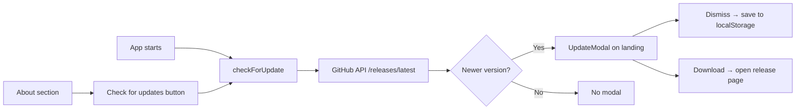

# Requirements

### Overview
Add an in-app update notification modal that checks for new releases on GitHub and displays a "What's New" modal when a newer stable version is available. The modal should use the same centered overlay design as the existing `Welcome`, `ExpiredDialog`, and `ExitDialog` components.

### Scope

**In Scope:**
- New `UpdateModal` component with glass-float centered card design
- GitHub Releases API check on app start (fetches latest stable release from `arjan001/StreamX`)
- Modal appears on landing page after catalogue loads AND in the About section of Settings
- Shows version number, "What's New in v1.x.x" title, and changelog from GitHub release notes
- "Download" button linking to the download page, "Dismiss" to close
- Dismissed updates are remembered per version (no repeat nag)
- `RELEASE_COMMANDS.md` guide for the AI explaining build bumps vs major releases

**Out of Scope:**
- Modifying CI workflow or versioning scripts (as requested — no changes to existing infrastructure)
- Auto-download or auto-install of APKs
- Server-side update config (uses GitHub API directly)

# Technical Design

### Current Implementation

**Modal design patterns found:**
- `Welcome.tsx` — centered overlay, `z-[70]`, `bg-black/35`, `data-nav-contain`, `focusFirst`, glass-float card with `welcome-card tally-glow` for modern shell
- `ExpiredDialog.tsx` — same pattern, `z-[72]`, `bg-black/60`, dismissible with buttons
- `ExitDialog.tsx` — same pattern, phases, `pushBackHandler` to trap BACK
- All use: `anim-fade` overlay, `glass-float` card, `welcome-card` class for modern shell, solid card for classic

**Version info:**
- `version.json`: `{ "version": "1.64.1", "build": 203 }`
- Stamped at build time into `VITE_APP_VERSION` env var
- Read in `legal/index.ts` as `appVersion()` and in `More.tsx` About section

**GitHub repo:** `arjan001/StreamX` (confirmed via `git remote -v`)

### Proposed Changes

**1. New file: `apps/web/src/lib/updateCheck.ts`**
- `checkForUpdate()` — fetches latest stable release from GitHub API (`api.github.com/repos/arjan001/StreamX/releases/latest`)
- Compares returned tag version with current `VITE_APP_VERSION`
- Returns `{ available: boolean, version: string, body: string, html_url: string }` or null
- Uses `localStorage` to remember dismissed versions so the same update isn't shown repeatedly
- Timeout: 5 seconds, fails silently (no update shown on network error)

**2. New file: `apps/web/src/components/UpdateModal.tsx`**
- Props: `{ release: { version, body, html_url } | null; onDismiss: () => void }`
- Same design as `ExpiredDialog` / `ExitDialog`:
  - `anim-fade fixed inset-0 z-[71] flex items-center justify-center bg-black/35`
  - Modern shell: `welcome-card glass-float tally-glow is-on w-full max-w-[26rem]`
  - Classic shell: `card w-full max-w-[26rem] border border-rule bg-panel`
  - `data-nav-contain`, `focusFirst` on mount
- Content:
  - Title: "What's new in v{version}"
  - Scrollable changelog body (GitHub release notes rendered as plain text, max-height with scroll)
  - Two buttons: "Download" (opens release page) and "Dismiss" (closes, remembers version)
- If no release, renders null

**3. Modify: `apps/web/src/main.tsx`**
- After the Welcome/first-run flow completes, call `checkForUpdate()`
- If update available, mount `<UpdateModal>` alongside the shell
- Modal shows after catalogue loads (not during sign-in)

**4. Modify: `apps/web/src/routes/More.tsx`**
- In the About section pane, add a "Check for updates" row
- On click, triggers `checkForUpdate()` and shows the UpdateModal inline
- If an update is available, show a small banner: "New release available v1.x.x [UPDATE]"

**5. New file: `RELEASE_COMMANDS.md`**
- Guide for telling the AI what to do:
  - "Build bump" → run `pnpm version:bump build` (increments build number only)
  - "Major release" → run `pnpm version:bump minor` (or patch/major), then commit and push
  - Explains the difference between build numbers and version numbers
  - Explains how GitHub releases are created automatically by CI

### Architecture Diagram

### Key Decisions
- **GitHub API directly** — no server proxy needed; the API is public and rate-limited at 60/hour unauthenticated, which is sufficient for app boot checks
- **z-[71]** — between Welcome (z-[70]) and ExpiredDialog (z-[72]) so it doesn't conflict with critical dialogs
- **Dismiss remembered per version** — stored in localStorage as `update.dismissed.v1.65.0` so the user isn't nagged repeatedly
- **Changelog from GitHub** — uses the release body directly from the API, no separate changelog endpoint needed

# Delivery Steps

### ✓ Step 1: Create update check logic and RELEASE_COMMANDS.md
Implement the GitHub release check and the release commands guide.
- Create `apps/web/src/lib/updateCheck.ts` with `checkForUpdate()` that fetches latest stable release from `api.github.com/repos/arjan001/StreamX/releases/latest`, compares with current `VITE_APP_VERSION`, and returns release info or null.
- Add localStorage-based dismissal tracking so dismissed versions aren't shown again.
- Create `RELEASE_COMMANDS.md` at project root explaining build bumps vs major releases, with exact commands and when to use each.
- Verified TypeScript compilation passes (same pattern as `legal/index.ts`).

### ✓ Step 2: Create UpdateModal component
Build the centered overlay modal matching existing dialog design.
- Create `apps/web/src/components/UpdateModal.tsx` with the same glass-float card pattern as `ExpiredDialog.tsx` and `ExitDialog.tsx`.
- Modal shows "What's new in v{version}" title, scrollable changelog body, Download button (opens GitHub release page), and Dismiss button.
- Uses `data-nav-contain`, `focusFirst`, `anim-fade`, and proper z-index (z-[71]).
- Supports both modern (glass-float + tally-glow) and classic (solid card) shells via `useSkin()`.
- Verified TypeScript compilation passes.

### ✓ Step 3: Integrate modal into app and About section
Wire the update check and modal into the app lifecycle and Settings.
- Modified `apps/web/src/main.tsx` to call `checkForUpdate()` after the Welcome/first-run flow completes and mount `<UpdateModal>` if an update is available.
- Modified `apps/web/src/routes/More.tsx` About section to add a "Check for updates" row and show a "New release available" banner when an update exists.
- The modal does not interfere with existing dialogs (Welcome, ExpiredDialog, ExitDialog) by using z-[71].
- Verify TypeScript compilation passes with `npx tsc --noEmit`.